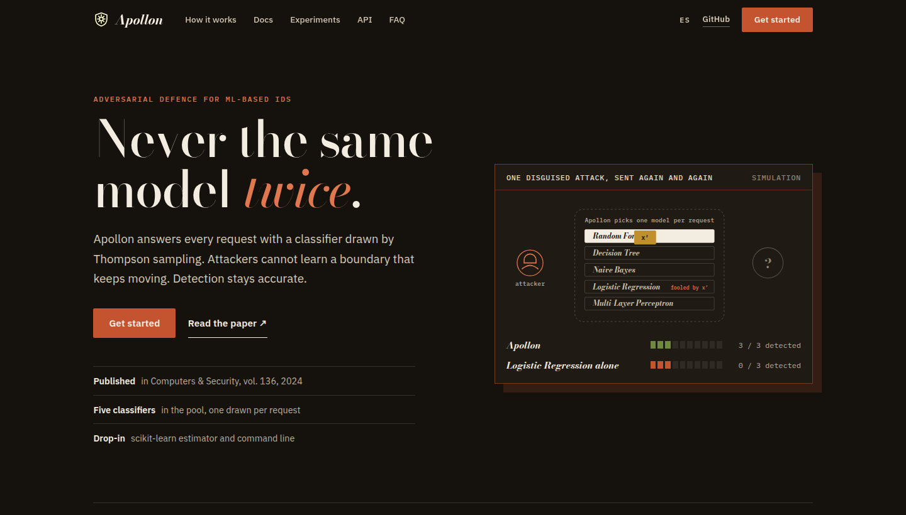
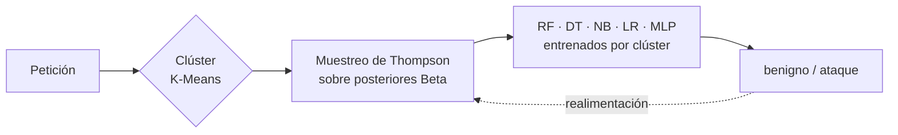

<p align="center">
  
</p>

<h1 align="center">Apollon</h1>

<p align="center">
  <b>Un sistema de defensa robusto frente a ataques de aprendizaje automático adversario en sistemas de detección de intrusiones</b>
</p>

<p align="center">
  <a href="https://doi.org/10.1016/j.cose.2023.103546"></a>
  <a href="https://doi.org/10.1016/j.cose.2023.103546"></a>
  <a href="https://github.com/antoniopaya22/apollon/actions/workflows/ci.yml"></a>
  <a href="https://antoniopaya22.github.io/apollon/"></a>
  
  <a href="LICENSE"></a>
</p>

<p align="center">
  <a href="https://antoniopaya22.github.io/apollon/es/">Documentación</a> ·
  <a href="https://antoniopaya22.github.io/apollon/es/getting-started/quickstart/">Inicio rápido</a> ·
  <a href="https://antoniopaya22.github.io/apollon/es/experiments/">Experimentos</a> ·
  <a href="https://doi.org/10.1016/j.cose.2023.103546">Artículo</a> ·
  <a href="#cómo-citar">Citar</a> ·
  <a href="README.md">English</a>
</p>

<p align="center">
  <a href="https://antoniopaya22.github.io/apollon/"></a>
</p>

---

Implementación oficial de **[Apollon: A robust defense system against Adversarial
Machine Learning attacks in Intrusion Detection Systems](https://doi.org/10.1016/j.cose.2023.103546)**,
*Computers & Security*, vol. 136, 103546 (2024).

Un atacante puede evadir un sistema de detección de intrusiones basado en aprendizaje
automático si lo consulta, aprende su frontera de decisión y fabrica ejemplos
adversarios. **Apollon nunca le da al atacante un modelo fijo que aprender**: cada
petición la responde un clasificador elegido de un conjunto diverso por un **bandido
multibrazo con muestreo de Thompson** por clúster. La frontera que sondea el atacante
cambia sin parar, mientras el bandido favorece a los clasificadores que mejor funcionan
en cada tipo de tráfico, así que la detección del tráfico normal no se resiente.



## Instalación

```bash
pip install "apollon-ids @ git+https://github.com/antoniopaya22/apollon"
# con los ataques adversarios (ZOO, HopSkipJump)
pip install "apollon-ids[attacks] @ git+https://github.com/antoniopaya22/apollon"
```

Python 3.10 o superior. La [guía de instalación](https://antoniopaya22.github.io/apollon/es/getting-started/installation/)
explica la instalación para desarrollo.

## Inicio rápido

```python
from apollon import ApollonMAB
from apollon.data import prepare
from apollon.metrics import evaluate, format_metrics

data = prepare("cic-ids2017", ["data/CIC-IDS2017/"])     # CSV originales -> partición escalada
model = ApollonMAB(random_state=0).fit(data.X_train, data.y_train)

pred, arms = model.predict(data.X_test, return_arms=True)  # un sorteo de Thompson por petición
print(format_metrics(evaluate(data.y_test, pred)))
model.update(data.X_test[:100], data.y_test[:100])         # aprende de la realimentación
```

O desde la línea de comandos:

```bash
apollon demo                                                       # datos sintéticos, sin descargas
apollon prepare  --dataset cic-ids2017 --raw data/CIC-IDS2017 --out data/cic17.npz
apollon train    --data data/cic17.npz --out models/cic17.joblib
apollon evaluate --data data/cic17.npz --model models/cic17.joblib
apollon attack   --data data/cic17.npz --model models/cic17.joblib --attack hsja --setting direct
```

## Características

- **Defensa de blanco móvil**: muestreo de Thompson sobre un conjunto diverso de
  clasificadores, entrenados en cada clúster K-Means del tráfico.
- **Aprendizaje en línea**: la realimentación de los analistas actualiza las posteriores
  Beta (`update`).
- **API de scikit-learn**: `fit`, `predict`, `predict_proba`, `get_params`; cualquier
  clasificador de scikit-learn puede entrar en el conjunto.
- **Carga de datasets** de CIC-IDS2017, CSE-CIC-IDS2018 y CIC-DDoS2019 con el
  preprocesado del artículo.
- **Evaluación adversaria** con ZOO y HopSkipJump (ART), en los escenarios directo y de
  transferencia, con las características funcionales fijas.
- **Línea de comandos**, semillas fijas, tests e integración continua.

## Estructura del repositorio

```text
src/apollon/        el paquete: ApollonMAB, conjunto de clasificadores, datos, ataques, métricas, CLI
tests/              tests unitarios y de extremo a extremo con datos sintéticos
docs/               web de documentación (MkDocs Material), en inglés y español
examples/           ejemplos ejecutables
research/           notebooks, scripts y salidas originales del artículo
```

## Documentación

Documentación completa en **https://antoniopaya22.github.io/apollon/es/**: cómo funciona
Apollon, datasets, entrenamiento, evaluación adversaria, experimentos, línea de comandos
y referencia de la API. Para verla en local: `pip install -e ".[docs]" && mkdocs serve`.

## Cómo citar

Si usas Apollon en tu investigación, cita:

```bibtex
@article{paya2024apollon,
  title   = {Apollon: A robust defense system against Adversarial Machine Learning attacks in Intrusion Detection Systems},
  author  = {Pay{\'a}, Antonio and Arroni, Sergio and Garc{\'i}a-D{\'i}az, Vicente and G{\'o}mez, Alberto},
  journal = {Computers \& Security},
  volume  = {136},
  pages   = {103546},
  year    = {2024},
  doi     = {10.1016/j.cose.2023.103546}
}
```

## Contribuir

Las contribuciones son bienvenidas. Consulta [CONTRIBUTING.md](CONTRIBUTING.md).

## Licencia

[Apache License 2.0](LICENSE).
