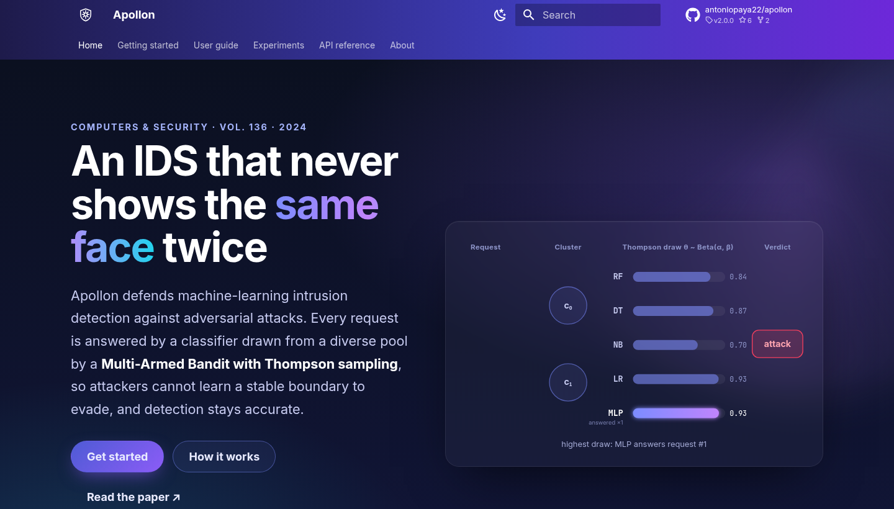
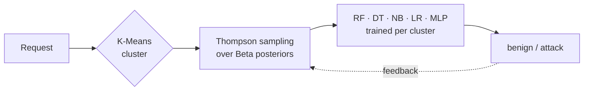

<p align="center">
  
</p>

<h1 align="center">Apollon</h1>

<p align="center">
  <b>A robust defence system against adversarial machine learning attacks in intrusion detection systems</b>
</p>

<p align="center">
  <a href="https://doi.org/10.1016/j.cose.2023.103546"></a>
  <a href="https://doi.org/10.1016/j.cose.2023.103546"></a>
  <a href="https://github.com/antoniopaya22/apollon/actions/workflows/ci.yml"></a>
  <a href="https://antoniopaya22.github.io/apollon/"></a>
  
  <a href="LICENSE"></a>
</p>

<p align="center">
  <a href="https://antoniopaya22.github.io/apollon/">Documentation</a> ·
  <a href="https://antoniopaya22.github.io/apollon/getting-started/quickstart/">Quickstart</a> ·
  <a href="https://antoniopaya22.github.io/apollon/experiments/">Experiments</a> ·
  <a href="https://doi.org/10.1016/j.cose.2023.103546">Paper</a> ·
  <a href="#citation">Cite</a>
</p>

<p align="center">
  <a href="https://antoniopaya22.github.io/apollon/"></a>
</p>

---

Official implementation of **[Apollon: A robust defense system against Adversarial
Machine Learning attacks in Intrusion Detection Systems](https://doi.org/10.1016/j.cose.2023.103546)**,
*Computers & Security*, vol. 136, 103546 (2024).

Machine-learning intrusion detection systems can be evaded by attackers who query them,
learn their decision boundary and craft adversarial examples. **Apollon never gives the
attacker a fixed model to learn**: every request is answered by a classifier drawn from a
diverse pool by a per-cluster **Multi-Armed Bandit with Thompson sampling**. The
decision boundary that the attacker probes keeps changing, while the bandit favours the
classifiers that perform best on each kind of traffic, so detection of ordinary traffic
is not compromised.



## Installation

```bash
pip install "apollon-ids @ git+https://github.com/antoniopaya22/apollon"
# with the adversarial attacks (ZOO, HopSkipJump)
pip install "apollon-ids[attacks] @ git+https://github.com/antoniopaya22/apollon"
```

Python 3.10 or newer. See the [installation guide](https://antoniopaya22.github.io/apollon/getting-started/installation/)
for development installs.

## Quickstart

```python
from apollon import ApollonMAB
from apollon.data import prepare
from apollon.metrics import evaluate, format_metrics

data = prepare("cic-ids2017", ["data/CIC-IDS2017/"])     # raw CSVs -> scaled split
model = ApollonMAB(random_state=0).fit(data.X_train, data.y_train)

pred, arms = model.predict(data.X_test, return_arms=True)  # one Thompson draw per request
print(format_metrics(evaluate(data.y_test, pred)))
model.update(data.X_test[:100], data.y_test[:100])         # learn from analyst feedback
```

Or from the command line:

```bash
apollon demo                                                       # synthetic data, no download
apollon prepare  --dataset cic-ids2017 --raw data/CIC-IDS2017 --out data/cic17.npz
apollon train    --data data/cic17.npz --out models/cic17.joblib
apollon evaluate --data data/cic17.npz --model models/cic17.joblib
apollon attack   --data data/cic17.npz --model models/cic17.joblib --attack hsja --setting direct
```

## Features

- **Moving-target defence**: Thompson sampling over a diverse classifier pool, trained
  per K-Means cluster of traffic.
- **Online learning**: analyst feedback updates the Beta posteriors (`update`).
- **Scikit-learn API**: `fit`, `predict`, `predict_proba`, `get_params`; any
  scikit-learn classifier can join the pool.
- **Dataset loaders** for CIC-IDS2017, CSE-CIC-IDS2018 and CIC-DDoS2019 with the
  preprocessing of the paper.
- **Adversarial evaluation** with ZOO and HopSkipJump (ART), in direct and transfer
  settings, keeping functional features fixed.
- **Command line interface**, fixed seeds, tests and continuous integration.

## Repository layout

```text
src/apollon/        the package: ApollonMAB, classifier pool, data, attacks, metrics, CLI
tests/              unit and end-to-end tests on synthetic data
docs/               documentation site (MkDocs Material)
examples/           runnable examples
research/           original notebooks, scripts and recorded outputs of the paper
```

## Documentation

Full documentation at **https://antoniopaya22.github.io/apollon/**: how Apollon works,
datasets, training, adversarial evaluation, experiments, command line and API reference.
To build it locally: `pip install -e ".[docs]" && mkdocs serve`.

## Citation

If you use Apollon in your research, please cite:

```bibtex
@article{paya2024apollon,
  title   = {Apollon: A robust defense system against Adversarial Machine Learning attacks in Intrusion Detection Systems},
  author  = {Pay{\'a}, Antonio and Arroni, Sergio and Garc{\'i}a-D{\'i}az, Vicente and G{\'o}mez, Alberto},
  journal = {Computers \& Security},
  volume  = {136},
  pages   = {103546},
  year    = {2024},
  doi     = {10.1016/j.cose.2023.103546}
}
```

## Contributing

Contributions are welcome. See [CONTRIBUTING.md](CONTRIBUTING.md).

## License

[Apache License 2.0](LICENSE).
