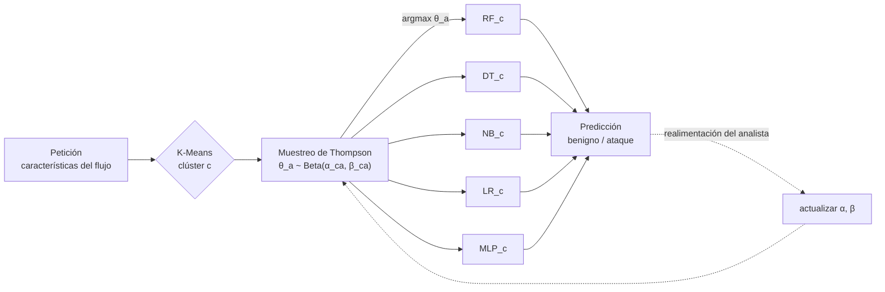

# Cómo funciona Apollon

Apollon envuelve un conjunto de clasificadores de detección de intrusiones. Para cada petición
(un flujo de red descrito por sus características) decide *qué* clasificador responde, y toma
esa decisión con un problema de bandido multibrazo (Multi-Armed Bandit, MAB) resuelto mediante
muestreo de Thompson (Thompson sampling).



## Por qué un blanco móvil

Los ataques adversarios de caja negra, como ZOO y HopSkipJump, consultan el IDS muchas veces
y usan las respuestas para estimar su frontera de decisión; después desplazan un ataque al
otro lado de esa frontera con la menor perturbación posible. Estos ataques suponen que el
mismo modelo responde a todas las consultas. Apollon rompe esa suposición: consultas
consecutivas, incluso sobre la misma entrada, pueden ser respondidas por clasificadores
distintos con fronteras distintas. Las estimaciones del gradiente o de la frontera que hace
el atacante mezclan varios modelos, y un ejemplo adversario que cruza la frontera de un
clasificador todavía tiene que superar a los demás, que pueden responderle más adelante.

## Los tres componentes

### 1. Un conjunto diverso

Los brazos son clasificadores de familias distintas, por lo que sus errores también son
distintos. El conjunto del artículo es:

| Brazo | Modelo | Configuración |
|---|---|---|
| `RF` | Random Forest | 100 árboles |
| `DT` | Decision Tree | por defecto |
| `NB` | Gaussian Naive Bayes | por defecto |
| `LR` | Logistic Regression | `max_iter=1000` |
| `MLP` | Multi-Layer Perceptron | una capa oculta de 32 unidades `tanh`, Adam, parada temprana |

También están disponibles `KNN` y `SVC`, y se puede pasar cualquier clasificador de
scikit-learn en `ApollonMAB(arms=[...])`. Consulta [Conjunto de clasificadores](../reference/pool.md).

### 2. Clústeres de tráfico

El tráfico es heterogéneo: el mejor clasificador para el tráfico DNS no es necesariamente el
mejor para HTTP. Apollon agrupa los datos de entrenamiento con K-Means (dos clústeres en el
artículo) y entrena cada brazo en cada clúster, de modo que cada clúster tiene su propio
conjunto especializado. Cada petición se asigna primero a su clúster y la responde después el
conjunto de ese clúster.

### 3. Muestreo de Thompson

Para cada clúster $c$ y brazo $a$, Apollon mantiene una posterior Beta sobre la probabilidad
$p_{ca}$ de que el brazo clasifique correctamente una petición de ese clúster:

$$
p_{ca} \sim \mathrm{Beta}(\alpha_{ca}, \beta_{ca}), \qquad
\alpha_{ca} = 1 + \text{correct}_{ca}, \quad \beta_{ca} = 1 + \text{errors}_{ca}.
$$

Los recuentos parten de una partición de validación reservada (por defecto, el 20 % de los
datos de entrenamiento). Para cada petición del clúster $c$, Apollon extrae
$\theta_a \sim \mathrm{Beta}(\alpha_{ca}, \beta_{ca})$ para cada brazo y deja que responda
$\arg\max_a \theta_a$. Un brazo con una media posterior alta responde a la mayoría de las
peticiones, pero las extracciones son aleatorias, así que cada brazo conserva una
probabilidad proporcional a lo plausible que sea que es el mejor.

Cuando se conoce la etiqueta real de las peticiones respondidas, por ejemplo después de que un
analista revise las alertas, [`update`](../reference/mab.md) añade el resultado a la posterior
del brazo que respondió:

$$
\alpha_{ca} \leftarrow \alpha_{ca} + \mathbb{1}[\hat y = y], \qquad
\beta_{ca} \leftarrow \beta_{ca} + \mathbb{1}[\hat y \neq y].
$$

## Pruébalo

Cuatro clasificadores de un clúster, con sus posteriores Beta. **Extraer una petición** toma
un valor de cada clasificador (las líneas verticales) y responde el que obtiene el valor más
alto. Después indica a Apollon si ese clasificador acertó: su posterior se desplaza.
**Ejecutar 200 peticiones** simula tráfico con realimentación del analista, en el que cada
clasificador acierta con su exactitud real: las posteriores se estrechan y los mejores
clasificadores responden a la mayoría de las peticiones, mientras que los demás conservan
alguna probabilidad.

<div class="ap-ts" id="ap-ts">
  <div class="ap-ts__plot"></div>
  <div class="ap-ts__bar">
    <button type="button" class="primary" data-act="draw">Extraer una petición</button>
    <button type="button" data-act="ok">✓ Acertó</button>
    <button type="button" data-act="ko">✗ Falló</button>
    <button type="button" data-act="run">Ejecutar 200 peticiones</button>
    <button type="button" data-act="reset">Reiniciar</button>
    <span class="ap-ts__msg">Extrae una petición para empezar.</span>
  </div>
</div>

## Exploración y mezcla de brazos

Con muchas muestras de validación, las posteriores se vuelven muy concentradas y la selección
se centra en el mejor brazo de cada clúster. `prior_strength` reescala los recuentos de
validación de cada par (clúster, brazo) a un número fijo de pseudoobservaciones, lo que
mantiene las posteriores más anchas y la mezcla de brazos más variada. Sacrifica un poco de
exactitud a cambio de un IDS menos predecible:

```python
ApollonMAB(prior_strength=None)   # plain Thompson sampling on the validation counts
ApollonMAB(prior_strength=20)     # every (cluster, arm) starts from 20 pseudo-observations
```

`model.selection_frequencies(X)` informa de la mezcla y `model.posterior_means()`, de la
exactitud esperada de cada par (clúster, brazo).

## Coste de entrenamiento e inferencia

El entrenamiento ajusta `n_clusters × n_arms` clasificadores (10 con los valores por defecto)
más K-Means. La inferencia cuesta una asignación de K-Means, una extracción Beta por brazo y
la evaluación de **un** solo clasificador por petición, el mismo orden que un único modelo.
