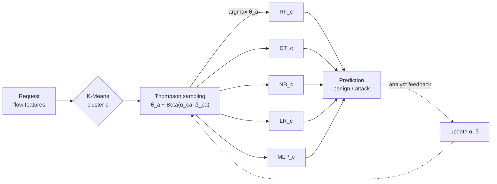

# How Apollon works

Apollon wraps a pool of intrusion detection classifiers. For every request (a network
flow described by its features) it decides *which* classifier answers, and it makes that
decision with a Multi-Armed Bandit (MAB) solved by Thompson sampling.



## Why a moving target

Black-box adversarial attacks such as ZOO and HopSkipJump query the IDS many times and
use the answers to estimate its decision boundary, then move an attack across it with
the smallest possible perturbation. They assume that the same model answers every
query. Apollon breaks that assumption: consecutive queries, even for the same input,
can be answered by different classifiers with different boundaries. The attacker's
estimates of the gradient or of the boundary mix several models, and an adversarial
example that crosses the boundary of one classifier still has to get past the others
that may answer it later.

## The three components

### 1. A diverse pool

The arms are classifiers of different families, so their errors differ. The paper's
pool is:

| Arm | Model | Settings |
|---|---|---|
| `RF` | Random Forest | 100 trees |
| `DT` | Decision Tree | default |
| `NB` | Gaussian Naive Bayes | default |
| `LR` | Logistic Regression | `max_iter=1000` |
| `MLP` | Multi-Layer Perceptron | one hidden layer of 32 `tanh` units, Adam, early stopping |

`KNN` and `SVC` are also available, and any scikit-learn classifier can be passed in
`ApollonMAB(arms=[...])`. See [Classifier pool](../reference/pool.md).

### 2. Clusters of traffic

Traffic is heterogeneous: the best classifier for DNS traffic is not necessarily the best
for HTTP. Apollon groups the training data with K-Means (two clusters in the paper) and
trains every arm on every cluster, so each cluster has its own specialised pool. A
request is first assigned to its cluster and then answered by that cluster's pool.

### 3. Thompson sampling

For each cluster $c$ and arm $a$, Apollon keeps a Beta posterior over the probability
$p_{ca}$ that the arm classifies a request of that cluster correctly:

$$
p_{ca} \sim \mathrm{Beta}(\alpha_{ca}, \beta_{ca}), \qquad
\alpha_{ca} = 1 + \text{correct}_{ca}, \quad \beta_{ca} = 1 + \text{errors}_{ca}.
$$

The counts start from a held-out validation split (20 % of the training data by
default). For every request of cluster $c$, Apollon draws
$\theta_a \sim \mathrm{Beta}(\alpha_{ca}, \beta_{ca})$ for every arm and lets
$\arg\max_a \theta_a$ answer. An arm with a high posterior mean answers most requests,
but the draws are random, so every arm keeps a chance proportional to how plausible it is
that it is the best.

When the ground truth of answered requests becomes known, for instance after an analyst
reviews alerts, [`update`](../reference/mab.md) adds the outcome to the posterior of the
arm that answered:

$$
\alpha_{ca} \leftarrow \alpha_{ca} + \mathbb{1}[\hat y = y], \qquad
\beta_{ca} \leftarrow \beta_{ca} + \mathbb{1}[\hat y \neq y].
$$

## Exploration and the arm mix

With many validation samples the posteriors become sharp and the selection concentrates
on the best arm of each cluster. `prior_strength` rescales the validation counts of each
(cluster, arm) to a fixed number of pseudo-observations, which keeps the posteriors wider
and the arm mix more varied. It trades a little accuracy for a less predictable IDS:

```python
ApollonMAB(prior_strength=None)   # plain Thompson sampling on the validation counts
ApollonMAB(prior_strength=20)     # every (cluster, arm) starts from 20 pseudo-observations
```

`model.selection_frequencies(X)` reports the mix and `model.posterior_means()` the
expected accuracy of every (cluster, arm).

## Training and inference cost

Training fits `n_clusters × n_arms` classifiers (10 with the defaults) plus K-Means.
Inference costs one K-Means assignment, one Beta draw per arm and **one** classifier
evaluation per request, the same order as a single model.
